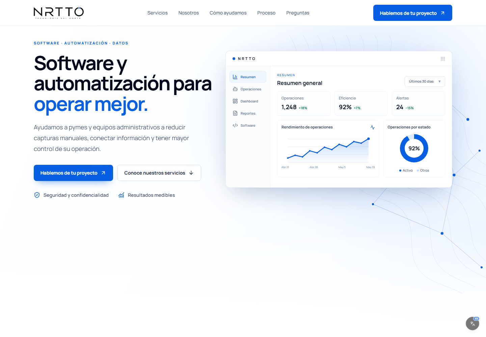
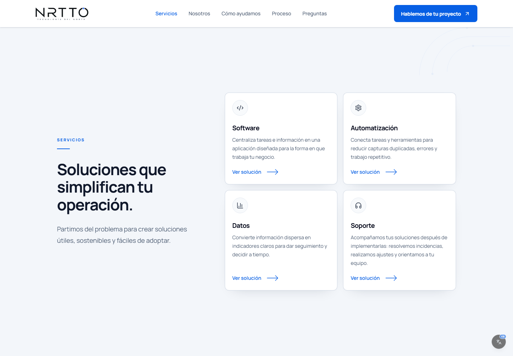
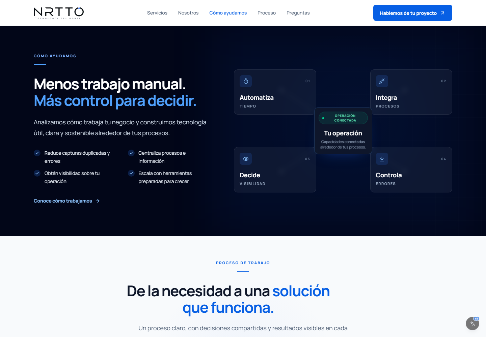
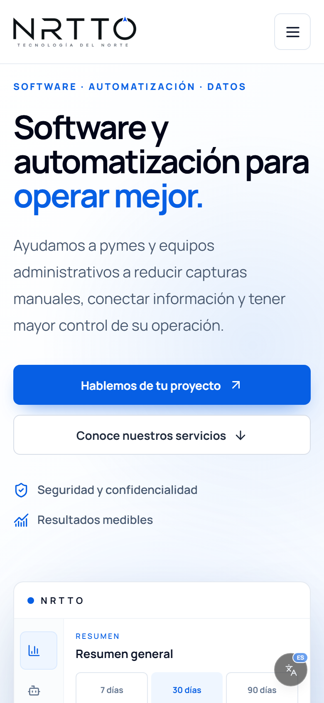
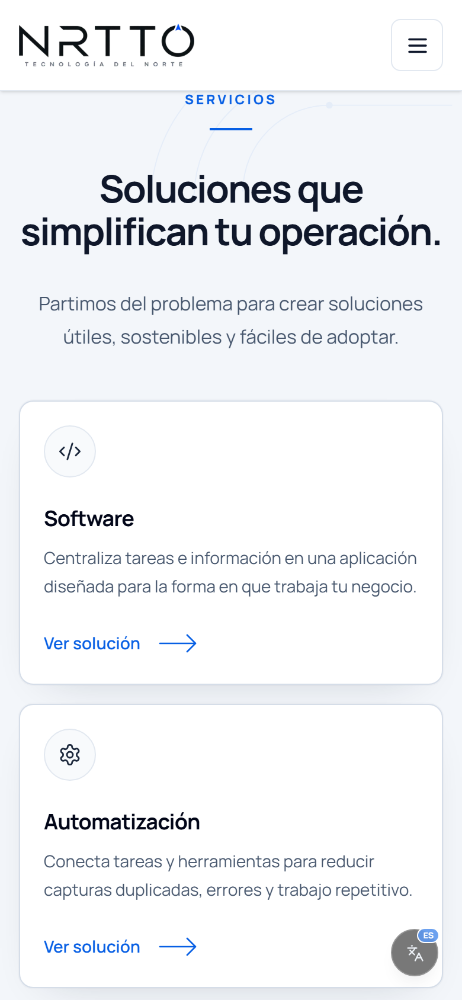

  
  <h1>NRTTO — Sitio Web Corporativo</h1>
  
<strong>Tecnología práctica para transformar operaciones.</strong>

  

    <a href="https://nrtto.netlify.app/"><strong>Ver sitio en vivo ↗</strong></a>
    &nbsp;&nbsp;·&nbsp;&nbsp;
    <a href="https://github.com/JosueLuceroG">Volver al perfil de GitHub ↗</a>
  

---

> [!IMPORTANT]
> Este repositorio contiene únicamente material de presentación. El código fuente de NRTTO es privado y no se distribuye aquí.

## El proyecto

NRTTO es el sitio corporativo de **NRTTO · Tecnología del Norte**, una propuesta enfocada en software, automatización, datos y soporte para pymes y equipos administrativos.

La experiencia comunica una idea central: reducir trabajo manual, conectar información y dar mayor control sobre la operación. El recorrido presenta los servicios, el enfoque de trabajo, el proceso, preguntas frecuentes y un formulario de contacto.

## Lo que muestra el sitio

- **Software:** aplicaciones para centralizar tareas e información.
- **Automatización:** conexión de herramientas para reducir capturas duplicadas, errores y trabajo repetitivo.
- **Datos:** indicadores claros para dar seguimiento y decidir a tiempo.
- **Soporte:** acompañamiento después de la implementación.
- **Dashboard operativo:** una vista de demostración con indicadores y tendencias.
- **Diseño adaptable:** navegación y contenido preparados para escritorio y dispositivos móviles.
- **Accesibilidad:** controles visibles de idioma y ajustes de accesibilidad.

## Vista del producto

<table>
  <tr>
    <td width="50%" align="center">
      
       
      Servicios
    </td>
    <td width="50%" align="center">
      
       
      Cómo ayudamos
    </td>
  </tr>
</table>

### Experiencia móvil

  
  &nbsp;&nbsp;
  

Capturas obtenidas de la versión pública y verificadas en anchos de 1440 px y 390 px, sin desbordamiento horizontal.

## Tecnologías verificadas

| Capa | Tecnología |
| --- | --- |
| Framework | Next.js 16 |
| Interfaz | React 19 |
| Lenguaje | TypeScript 5 |
| Estilos | Tailwind CSS 4 |
| Iconografía | Lucide React |
| Despliegue | Netlify |

## Estado y despliegue

- **Estado:** sitio en línea.
- **Plataforma:** Netlify.
- **Código fuente:** privado.
- **Demostración pública:** [nrtto.netlify.app](https://nrtto.netlify.app/)

La disponibilidad del sitio puede variar por causas externas al repositorio de presentación.

## Enlaces

- [Sitio en vivo](https://nrtto.netlify.app/)
- [Perfil de Josué Lucero](https://github.com/JosueLuceroG)

---

  Material de presentación de NRTTO. Código fuente privado. Todos los derechos reservados.

